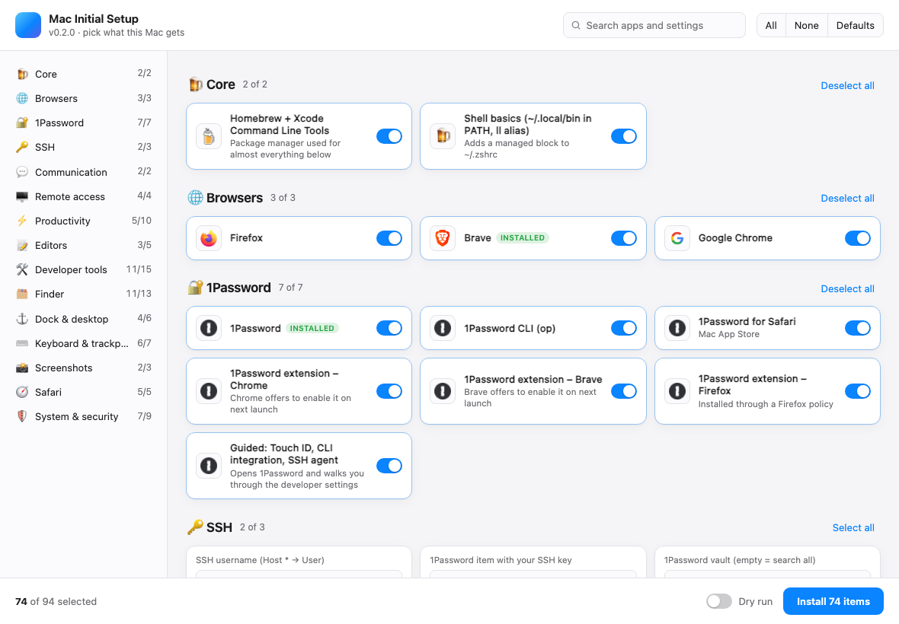

# mac-initial-setup

Set up a fresh Mac in one go: apps, developer tools, 1Password with SSH keys, and a long list of Finder, Dock, trackpad and Safari settings. A desktop app shows everything that can be installed, with icons and on/off switches. The defaults are an opinionated starting point: switch off what you don't want, fill in your own name and username, and click **Install**.

Free and open source (MIT). It runs on a brand-new Mac with nothing installed first.



**Requirements:** macOS on Apple Silicon or Intel, an admin account, and an internet connection. Sign in to the App Store first if you want the App Store apps.

## Quick start

On a brand-new Mac, open **Terminal** and paste:

```sh
curl -fsSL https://raw.githubusercontent.com/ronaldjonkers/mac-initial-setup/main/install.sh | bash
```

This downloads the latest release to `~/.mac-initial-setup` and opens the app:

- **Pick**: every app and setting is a card with a switch. Turn whole sections on or off, search, and fill in your SSH username, git name, Dock apps and other settings.
- **Dry run**: turn this on to see every command without changing anything.
- **Install**: enter your Mac password once. Progress is shown per item with a live log. When a step needs you, such as signing in to 1Password, a dialog asks for it.
- At the end you get a list of things that can't be automated, such as enabling browser extensions.

Prefer the terminal? `… | bash -s -- --tui` opens a keyboard-driven checklist instead. From a clone you can also run `./setup.sh`:

| Key | Action |
|---|---|
| ↑ ↓ / j k | Move |
| space / enter | Toggle an item, a whole section (on a header), or edit a value (✎) |
| a / n / d | Select all / none / restore the defaults |
| s | Start |
| q | Quit without changing anything |

### Options

```sh
./setup.sh --dry-run            # show every command, change nothing
./setup.sh --yes                # no checklist: install the defaults
./setup.sh --only dock-clean,tp-3finger
./setup.sh --enable vscode --disable xcode
./setup.sh --list               # all item ids and settings
MAC_SETUP_SSH_USER=jane MAC_SETUP_GIT_EMAIL=jane@example.com ./setup.sh
```

Everything is safe to run again. Installed apps are skipped, and existing `~/.ssh/config` files and SSH keys are backed up before they are replaced. A log is written to `~/Library/Logs/mac-initial-setup.log`.

## What's included

Items marked ○ are off by default.

- **Core**: Homebrew + Command Line Tools, shell PATH setup
- **Browsers**: Firefox, Brave, Chrome
- **1Password**: app, CLI, extensions for Safari, Chrome, Brave and Firefox, and a guided setup for Touch ID, CLI integration and the SSH agent
- **SSH**: `~/.ssh/config` with your username (`Host * / User / UseKeychain`), plus your key restored from 1Password with its passphrase in the Keychain, or ○ the 1Password SSH agent. See [docs/1password-ssh.md](docs/1password-ssh.md).
- **Communication**: WhatsApp, Telegram
- **Remote access**: Jump Desktop, Jump Desktop Connect, Termius, Windows App
- **Productivity**: TextSniper, [SpanWise](https://spanwise.pro), [MoreDisplays](https://moredisplays.com), [ClipLedger](https://clipledger.app) (latest release from their update feeds; SpanWise and ClipLedger are started right away and open at login), [AppCleaner](https://freemacsoft.net/appcleaner/), ○ Raycast, ○ Maccy, ○ Stats, ○ AdGuard Mini, ○ Logi Options+
- **Editors**: TextMate as the default app for text and code files (txt, md, json, php, html, css, js and about 50 more, without a confirmation dialog per type) and the `mate` command; ○ VS Code
- **Terminal tools**: git, gh, wget, telnet, jq, ripgrep, tree, htop, btop, fd, nmap, iperf3, HTTPie, watch, ffmpeg, `locate` (index built right away), [Mole](https://github.com/tw93/mole); ○ mtr, yq, fzf, bat, tldr, tmux, ImageMagick (`netstat` and `nc` come with macOS)
- **Programming languages**: PHP (latest, ○ 8.4, 8.3, 8.2 side by side), Composer, Node.js, uv (Python), Go, Rust, MySQL client, PostgreSQL client, SQLite; ○ pnpm, Bun, Deno, Ruby, Redis
- **Developer tools**: git config, Claude Code, Codex CLI, Kimi CLI, Sequel Ace, Xcode, TestFlight; ○ SQLPro for Postgres, OrbStack, Ghostty, iTerm2
- **Finder**: hidden files, extensions, path and status bar, full path in the title, list view, folders first, search the current folder, ~/Library visible, no .DS_Store files on network or USB drives
- **Dock**: cleaned up to a short list of apps (editable), no recent apps, Spaces stay in place, clicking the wallpaper doesn't hide your windows
- **Keyboard & trackpad**: three finger drag, natural scrolling off, tap to click, fast key repeat, no smart quotes
- **Screenshots**: copied to the clipboard instead of saved as a file; files you do save (⌘⇧5) go to ~/Screenshots
- **Safari**: doesn't open downloads automatically, Develop menu, full URL, status bar, no search suggestions sent to Apple
- **System**: Touch ID for `sudo`, expanded save dialogs, save to disk instead of iCloud, computer name (set when you fill it in); ○ firewall

App Store apps are installed with [`mas`](https://github.com/mas-cli/mas). Sign in to the App Store before you start.

## How it works

```
app/            Rust desktop app (tao + wry → native window with WKWebView), UI in app/ui/index.html
setup.sh        the engine: terminal checklist, or `--gui-run` when driven by the app
catalog.sh      every item and setting, in run order
lib/, modules/  installers and macOS tweaks (plain bash 3.2, ships with macOS)
```

The app reads the catalog with `setup.sh --json`, then runs `setup.sh --gui-run --only <ids>`. The engine reports progress as `::item-start::id`-style lines and reads answers to questions from stdin. The password is passed to `sudo` and Homebrew through a `SUDO_ASKPASS` helper in a private temporary folder, which is deleted when the run ends.

### Building

```sh
cd app && cargo run --release            # needs Rust (rustup.rs)
cargo run --release -- --dry-run         # start with dry run switched on
```

Releases are built on your own Mac, no CI needed:

```sh
./scripts/release.sh --build-only   # build + package into dist/
./scripts/release.sh --install      # build and install to ~/.mac-initial-setup, like the one-liner (for testing)
./scripts/release.sh v0.2.0         # also tag, push and upload as a GitHub release (needs `gh auth login`)
```

The script checks the shell scripts, builds a universal binary (Apple Silicon + Intel) and packages `mac-initial-setup.tar.gz`. `install.sh` always downloads the latest release.

## Make it yours

Everything lives in [`catalog.sh`](catalog.sh). Fork the repo, switch items `on` or `off`, change the default settings, or add a line:

```sh
item my-app on "My App" "cask my-app 'My App'" "Short description" "https://my-app.com"   # website = icon
```

Actions are plain shell commands. The available helpers are `cask`, `formula`, `appstore <id> <name>`, `sparkle_app <name> <appcast>` and `dw` (`defaults write`), and you can write your own functions in `modules/`.

## Notes

- Changing Safari settings requires **Full Disk Access** for your terminal (System Settings → Privacy & Security). The script opens that pane when it needs it.
- Trackpad, scrolling and key repeat changes take effect after you log out and back in.
- Some steps can't be scripted, such as signing in to 1Password or enabling a browser extension. These are listed at the end of the run.
- The app is not notarized. That's not a problem with the `curl` one-liner, because files downloaded with curl are not quarantined. If you download the release in a browser instead, right-click the app and choose Open the first time.

## Privacy and security

- Nothing is sent anywhere except the downloads themselves (Homebrew, the App Store, the apps' own update feeds). There is no tracking.
- Your Mac password stays on your Mac. It is written to a private temporary folder (readable only by you) so `sudo` and Homebrew can use it, and that folder is deleted when the run ends or the app is closed.
- The app icons are loaded from DuckDuckGo's favicon service, which sees which app websites are in the list. The installer itself never contacts it.
- Your SSH key is read from 1Password with the `op` CLI and only written to `~/.ssh`.

## Undoing things

Apps can be removed as usual (or with AppCleaner, which is in the list). Settings are plain `defaults write` commands, visible in [`modules/macos.sh`](modules/macos.sh) and in the log, so each one can be reverted with `defaults delete <domain> <key>`. Replaced files are kept next to the original with a `.backup-<date>` suffix, and the shell settings live in one marked block in `~/.zshrc` that you can delete.

## Troubleshooting

- Everything that happened is in `~/Library/Logs/mac-initial-setup.log`.
- Failed items are listed at the end with a command to retry only those: `./setup.sh --only id1,id2` from `~/.mac-initial-setup`.
- An App Store app that fails to install usually means you're not signed in to the App Store, or the app was never "bought" with your Apple ID. The App Store page is opened so you can get it there.

## License

MIT
